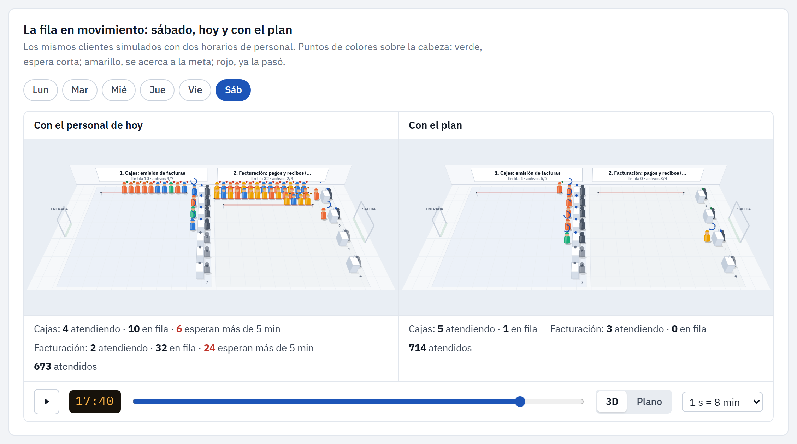
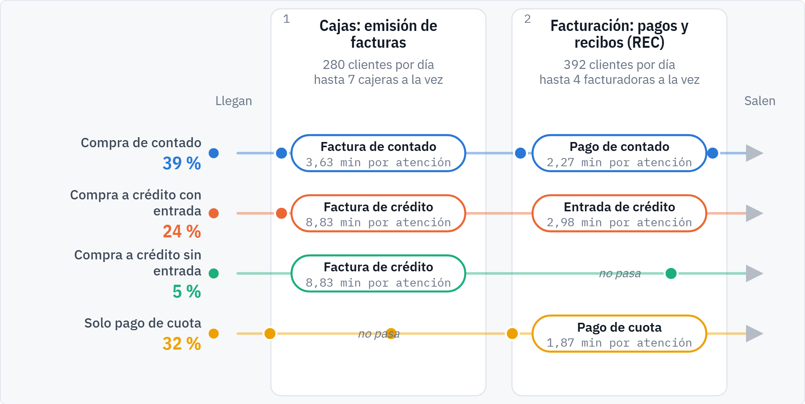
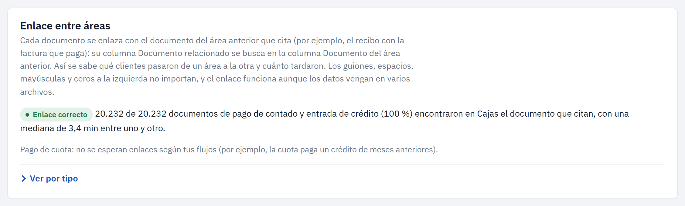
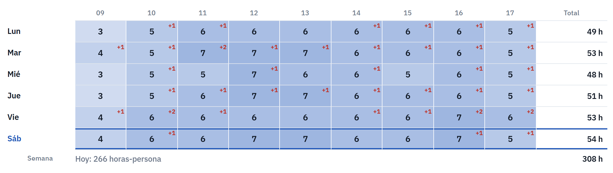
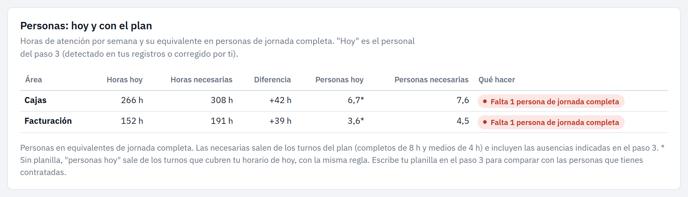

# Simulador de Colas

**¿Cuántas personas necesitas en cada área y en cada hora?** El simulador lo calcula con los datos de tu propio sistema (facturas, recibos, tickets o turnos): mide tu operación, completa con mediciones en tienda lo que los reportes no guardan, valida el modelo contra lo que pasó y arma el plan de personal con teoría de colas y simulación. Pensado para analistas de procesos y de recursos humanos.

**Pruébalo en línea:** https://christianivan42-dotcom.github.io/Simulador-Colas/ — abre con una tienda de ejemplo. Los archivos que subas se procesan en tu navegador y no se envían a ningún servidor.



## Cómo abrirlo

1. Abre `index.html` con doble clic (Chrome, Edge o Firefox actualizados).
2. Funciona **sin internet**: todas las librerías están en `vendor/`. Con conexión, además se cargan las tipografías.
3. Tus datos se procesan solo en tu navegador; no se envían a ningún servidor.

No requiere instalación ni servidor. Los ajustes y el último escenario se recuerdan en el navegador.

## Capturas

Tienda de ejemplo con datos ficticios.

| | |
|---|---|
|  |  |
| **Tu proceso medido**: qué camino sigue cada cliente y cuánto tarda cada atención. | **Enlace factura → recibo**: por número de documento, aunque los datos vengan en varios archivos. |
|  |  |
| **Plan por hora**: personas necesarias en cada hora; +1 falta una persona, −1 sobra una. | **Personas hoy y con el plan**: cuántas de jornada completa o medio tiempo faltan o sobran. |

## Cómo está organizado

Un recorrido guiado de cinco pasos, siempre visible a la izquierda, y una guía de uso a la derecha (botón **Guía**) que explica cada paso: qué hacer, qué necesitas, cómo se calcula y preguntas frecuentes. **Manual de uso** reúne la guía de todos los pasos.

| Paso | Qué haces | Qué obtienes |
|---|---|---|
| **1. Tu operación** | Eliges el modelo de atención (por ejemplo, cajas que emiten facturas y facturación que cobra y emite recibos REC) y escribes tu meta: qué porcentaje de clientes debe esperar menos de cuántos minutos. | El mapa del proceso con los tipos de cliente. |
| **2. Tus datos** | Subes **un solo archivo** con todas las transacciones (columna Área incluida); la app lo reparte entre las áreas. También acepta un archivo por área y varios archivos (por ejemplo, uno por mes). | Clientes por hora, personal presente, tipos de cliente, tiempo entre áreas y horario de atención. |
| **3. Personal y mediciones** | Revisas el personal actual por hora (detectado en tus registros, corregible) y, si quieres, tu planilla. Si tu archivo no trae la hora de inicio de cada atención, mides en tienda con el cronómetro la atención y el traslado entre áreas. | Personal de hoy confirmado y tiempos reales. Mientras falten mediciones, los resultados se marcan como preliminares. |
| **4. Diagnóstico** | Ves **tu fila en movimiento** (plana o 3D) con el personal de hoy, y la semana simulada y comparada con tus datos. | Validación del modelo, horas fuera de la meta, horas con personal de sobra, efecto de los días de pago y temporadas por mes. |
| **5. Plan de personal** | Eliges tipo de día (normal, día de pago, muy cargado), mes y cambio de demanda. | La fila en movimiento **hoy y con el plan, lado a lado**; personas que te sobran o te faltan en cada área (horas y equivalentes de jornada completa, contra tu planilla); personas por hora y por día; turnos; comparación de cambios ("¿y si…?"). |

**Herramientas** (al final de la lista de pasos) reúne lo que es para especialistas: simulador libre, fórmulas de colas, personal por intervalo, análisis de series, planeación por temporada con conteos o totales, registro en tienda, estándar de datos con verificador, validación de los cálculos y la metodología con la bibliografía.

Al abrirla por primera vez se carga una tienda de ejemplo (4 meses de facturas y recibos, con mediciones de muestra), marcada como ejemplo en cada paso; **Usar mis reportes** la reemplaza por tus datos.

## ¿Qué archivos necesito?

**Un archivo principal siempre; complementos solo si hacen falta.**

| Tu situación | Qué preparar | Archivos |
|---|---|---|
| Tengo sistema que registra cada cliente (punto de venta, turnero, ERP) | Reporte de 2 a 5 años, una fila por ticket/turno | 1 |
| Mi sistema da conteos por hora (conmutador, contador de personas) | Reporte por intervalo; si no trae tiempo de atención, una muestra cronometrada o el promedio | 1 (+1 opcional) |
| Mi sistema solo da totales por día | Totales diarios de 2 a 5 años; para el reparto por hora, 1 a 4 semanas de conteo por hora (si no, se usa el perfil típico del giro) | 1 (+1 opcional) |
| No tengo sistema | Conteo por hora de 2 a 4 semanas; 50 a 200 tiempos cronometrados; opcional, ventas diarias de años anteriores | 1 (+2 opcionales) |
| No tengo datos | Estimaciones en el asistente | 0 |

El asistente muestra, para cada giro, qué reporte pedir a tu sistema y qué columnas debe tener, y permite descargar un archivo de ejemplo con ese formato. Las columnas se reconocen solas por su nombre (en español o inglés) y se pueden corregir. Se aceptan CSV y Excel; fechas `AAAA-MM-DD`, `DD/MM/AAAA`, con nombre de mes o número de serie de Excel; decimales con punto o coma; duraciones en minutos, segundos u `hh:mm:ss`.

Plantillas en `plantillas/` y datos de ejemplo en `datos_ejemplo/` (casi 5 años por hora de una sucursal ficticia, 2 semanas de tickets y 4 meses de facturas de cajas y recibos REC de una tienda con crédito).

### Estándar de datos (cualquier empresa o giro)

**Archivo único (la forma recomendada):** una fila por transacción con las columnas fecha y hora, **área**, quién atiende (el **usuario que creó el documento**; si no hay, la caja o el puesto) y tipo de transacción (obligatorias); número de documento, documento relacionado y cliente (recomendadas); y hora de inicio de la atención (con ella no hace falta cronometrar). Los nombres de las columnas pueden ser los de tu sistema. Con la columna Área, cada área toma sus filas y sus tipos solos; sin ella, los tipos que podrían ser de dos áreas quedan para que el usuario los asigne. Si el sistema lo entrega en varios archivos (por ejemplo, uno por mes) o en un Excel con una hoja por mes, se leen todos juntos; si dos archivos repiten días, las filas repetidas (mismo documento, misma hora) se cuentan una sola vez.

**Quién atiende.** Se prefiere el usuario que creó cada documento a la caja o el puesto: cada usuario que registra cuenta como una persona atendiendo en sus horas de trabajo, aunque cambie de caja. Se reconoce por su nombre (`USUARIO_CREACION`, `CREADO_POR`, `USR_CREA`, `CAJERO`…) y nunca se toma como una hora; quien modificó o anuló el documento no cuenta. Un usuario que registra en bloque (3 o más documentos en menos de 3 s: pagos en línea, procesos automáticos) se marca y el usuario decide si se cuenta.

**Enlace entre áreas.** El documento relacionado de cada recibo se busca en los documentos del área anterior, sin importar guiones, espacios, mayúsculas ni ceros a la izquierda (`F-001245` = `f1245` = `1245` de Excel); una celda puede citar varias facturas (`F-1245; F-1246`). Todo lo que combina las áreas (el enlace, los flujos y el modelo) usa el **periodo común**: las mismas semanas en todas las áreas, terminando el último día que todas tienen datos, y solo los días con movimiento en todas. Lo que un archivo trae fuera de ese periodo se usa para las temporadas. Si las áreas no tienen ni un día en común, se avisa y no se mide. El paso 2 muestra, por tipo, cuántos documentos encontraron el suyo.


Una fila por transacción con tres columnas mínimas: **fecha y hora**, **quién atiende** (usuario creador, o caja o puesto) y **tipo de transacción**. Recomendadas: número de documento, cliente y área. Opcionales: documento relacionado (la factura que paga un recibo), hora de inicio de la atención, hora de llegada (turnero), estado y monto. Según las columnas, el archivo alcanza un nivel:

| Nivel | Columnas | Tiempo de atención | Espera | Abandonos |
|---|---|---|---|---|
| 0 | Conteo manual y cronometraje | Cronometrado | No | No |
| 1 | Fecha y hora, punto y tipo | Cronometrar en tienda (sin medir, cota superior) | No | No |
| 2 | + documento relacionado u hora de inicio | Inferido o medido | Aproximada | No |
| 3 | + hora de llegada y estado (turnero) | Medido | Medida | Medido |

Plantilla y diccionario: `plantillas/estandar_datos_atencion.csv` y `plantillas/diccionario_de_datos.csv`.

## Estándar de modelación (paso 4, detalle técnico → ficha del modelo)

| Paso | Método | Referencia |
|---|---|---|
| 1. Sistema | Red de estaciones Mₜ/G/c(t)/∞/FIFO con clases de cliente y ruta propia | Kendall (1953); Baskett et al. (1975) |
| 2. Llegadas | Poisson no homogéneo por hora, día de la semana y tipo de cliente, dentro del horario de atención detectado; prueba del índice de dispersión; tipos de día medidos (días de pago, P75, P90); temporada por mes por descomposición clásica (sin tendencia con 24 meses o más) | Law (2015, §6.12); Kim y Whitt (2014); Whitt (2006); Makridakis et al. (1998) |
| 3. Rutas | Volumen de cada flujo por mínimos cuadrados no negativos | Lawson y Hanson (1974) |
| 4. Atención | Medida con la hora de inicio, cronometrada en tienda (estudio de tiempos con intervalo de confianza; distribución por AIC y Kolmogorov–Smirnov) o inferida del tiempo entre documentos con el traslado cronometrado (inferencia indirecta con llegadas reales). Sin medir: cota superior y resultado preliminar | Kanawaty (1992); Niebel y Freivalds (2009); Law (2015, cap. 6); Gouriéroux et al. (1993) |
| 5. Personal | c(t) observado; dimensionamiento con Erlang C por hora y ajuste por simulación de toda la red | Green, Kolesar y Soares (2001); Feldman et al. (2008) |
| 6. Abandono | Paciencia θ = P(abandono)/E[espera] con turnero | Mandelbaum y Zeltyn (2007) |
| 7. Diseño | Simulación terminante, 20 réplicas, IC 95 % t de Student, números aleatorios comunes | Law (2015, §9.4 y §11.2) |
| 8. Validación | Atenciones por hora simuladas vs. reales (error ≤ 10 %), tiempo entre documentos y espera medida | Sargent (2013) |

Cada modelo produce una ficha técnica descargable (CSV), el escenario en JSON y un script de Ciw para una segunda opinión independiente.

## Metodología del plan de personal

1. Descomposición estacional multiplicativa (razón a la media móvil 2×12), tendencia log-lineal, índices de día de la semana y del mes, efecto de eventos y feriados.
2. Pronóstico: regresión armónica diaria (enfoque de Prophet), Holt-Winters mensual y método ingenuo; se elige el de menor error en el último año fuera de muestra.
3. Cobertura de la demanda (promedio, P75, P90 o P95 de la razón real/esperado).
4. Demanda por hora → agentes por hora con Erlang C/A (meta de servicio y ocupación máxima) → merma → turnos óptimos (programación entera) → personas de jornada completa y medio tiempo → plantilla base y temporales por mes, más refuerzos para fechas especiales.

## Datos de varios años

Se pueden cargar todos los años que tengas. Se probó con 4,5 años de una tienda (474 591 facturas y 713 035 recibos, 73 MB en CSV): en el navegador cada archivo se lee en 2 a 4 segundos, el diagnóstico de la semana tarda 1 segundo y el plan, 2,5 segundos; el modelo ocupa unos 60 MB de memoria (las visitas se guardan en columnas numéricas y los números de documento como huellas de 52 bits). Para archivos grandes conviene CSV: Excel es más lento y admite como máximo 1 048 576 filas por hoja.

Con historia larga, el modelo de la operación (clientes por hora, personal presente, tiempos de atención, mezcla de tipos de cliente) usa el **periodo base**: las últimas 13 semanas por omisión (se puede cambiar a 8, 26 o 52 semanas, o todo el periodo). Así refleja cómo es la tienda hoy; promediar años con otra demanda subestima la actual (en la prueba de 4,5 años con +8 % anual, el promedio daba 11 % menos clientes en la hora pico). La historia completa se usa para las **temporadas por mes** (descomposición clásica, sin la tendencia con 24 meses o más) y para los **días de pago y días cargados** (cada día contra el mismo día de la semana de las 4 semanas vecinas, últimos 2 años). Para planear un mes, el índice del mes se divide entre el índice promedio del periodo base.

## Validación

Cada resultado es de uno de cuatro tipos, y la aplicación lo indica: **exacto** (fórmula de la teoría de colas o solución numérica exacta), **aproximado** (fórmula de la literatura con su error medido), **estimado** (simulación o estadística con intervalo de confianza) o **decisión de la empresa** (meta de servicio, turnos, cambio de demanda). Lo que los reportes no guardan se cronometra en tienda; mientras falte, el resultado se marca como preliminar. La matriz completa está en Herramientas → Validación de los cálculos.

Se probó también estimar la atención de cajas solo con la hora de las facturas (inferencia indirecta con los intervalos entre documentos): con carga media o alta el error llegó a 20–60 %, así que no se usa.

- `node tests/validacion.js`: 194 pruebas. Fórmulas contra valores de libro; una cadena de Markov resuelta por separado (eliminación gaussiana) que reproduce a 9 decimales los modelos de capacidad limitada, fuente finita, Erlang A y rechazo con abandono; Ley de Little en 12 modelos; dimensionamiento contra búsqueda exhaustiva (48 casos); simulación contra teoría en 20 modelos; rutas por tipo de cliente, llegadas reales y por tipo; la medición completa con los datos de ejemplo; mediciones con cronómetro, horario de atención detectado, temporadas por mes (recupera índices conocidos con error menor a 0,3 %) historia larga (2 años con crecimiento: el modelo toma el nivel de las últimas 13 semanas, los días cargados no se inflan con el crecimiento y el enlace factura → REC funciona con huellas de documento); reportes completos con hora de inicio (atención medida sin sesgo y nada que cronometrar); personal indicado por el usuario; varios archivos por área con columnas en otro orden; archivo único con todas las áreas (mismo resultado que un archivo por área); áreas con fechas distintas (el modelo usa el periodo común y todos los recibos que pagan una factura la encuentran) y sin fechas en común (se avisa); número de documento escrito distinto en la factura y en el recibo (guiones, mayúsculas, ceros que quita Excel, varias facturas en una celda); encabezados de ERP (usuario creador, fecha de creación); hora de inicio que no es inicio (se descarta); archivos que se superponen en fechas (filas repetidas contadas una vez); y usuario que registra en bloque (se detecta y se puede no contar).
- `node tests/precision_aproximaciones.js`: mide el error de las fórmulas aproximadas contra simulación larga (101 casos) y escribe `tests/PRECISION_APROXIMACIONES.md`. Kingman con KLB: error máximo 6 %; QNA: 6 %; percentil 90 de M/G/1: 8 %; M/G/c de dos momentos: mediana 6 %, hasta 38 %; Allen-Cunneen: mediana 6 %, hasta 49 % (los errores grandes, con esperas de segundos).
- `node tests/validar_medicion.js`: prueba la medición con datos en 7 escenarios con valores reales conocidos y escribe `tests/VALIDACION_MEDICION.md`. Flujos casi exactos (menos de medio punto); atención de facturación inferida entre −1 % y +5 % con el traslado cronometrado (sin medirlo, hasta +30 %); en cajas, el error de muestreo de 30 a 40 atenciones cronometradas (hasta ±26 % con atención muy variable); modelo con error por hora de 5 a 8 %.
- `python tests/validar_con_ciw.py` (requiere `pip install ciw`): validación cruzada con la biblioteca independiente Ciw.
- `node tests/generar_archivos_ejemplo.js`: regenera las plantillas y los datos de ejemplo.


Desde la aplicación se generan scripts de Python listos para usar con Ciw (validar un escenario), Prophet (pronóstico con feriados oficiales del país) y pyworkforce (turnos de varias semanas con OR-Tools).

## Estructura

```
index.html            Aplicación
css/app.css           Estilos (tema claro y oscuro)
js/                   Motor y módulos
  util.js, rng.js     Utilidades, generador aleatorio y distribuciones
  analytic.js         Modelos analíticos
  engine.js           Motor de simulación de eventos discretos (rutas por clase, llegadas por tipo y por traza)
  anim.js             Animación en Canvas: vista plana y vista 3D en perspectiva
  measure.js          Medición con datos del ERP, mediciones en tienda, temporadas, estándar de datos y de modelación
  ui-flow.js          Recorrido guiado de cinco pasos (la herramienta principal)
  help.js             Guía de uso de cada paso y manual
  ui-standard.js      Estándar de datos y verificador de archivos
  staffing.js         Erlang por intervalo y turnos óptimos
  data.js             Importación de datos y generador de ejemplos
  analysis.js         Estacionalidad, eventos, ajuste de distribuciones
  forecast.js         Pronóstico y plan de personal
  exporters.js        Scripts para Ciw, Prophet y pyworkforce
  sectors.js          Giros de negocio: vocabulario, metas típicas, qué datos pedir
  ui-wizard.js        Herramientas → Planeación por temporada (conteos, totales o estimaciones)
  ui-capture.js       Herramientas → Registro en tienda (sin sistema)
  ui-*.js, app.js     Resto de la interfaz
vendor/               Librerías de terceros con sus licencias
plantillas/           Plantillas CSV de carga
datos_ejemplo/        Datos ficticios para probar
tests/                Validación: validacion.js, precision_aproximaciones.js, validar_medicion.js y sus reportes .md
docs/capturas/        Capturas de pantalla del README
```

## Limitaciones

- Erlang por hora supone estado estable dentro de cada hora; en picos cortos o aperturas valida con el simulador.
- La demanda histórica de filas saturadas subestima la real: suma los abandonos y desistimientos si los tienes.
- Los cambios estructurales (nuevas sucursales, digitalización) no se pronostican: exclúyelos o márcalos como eventos.

## Licencia

© 2026 Christian Ivan.
